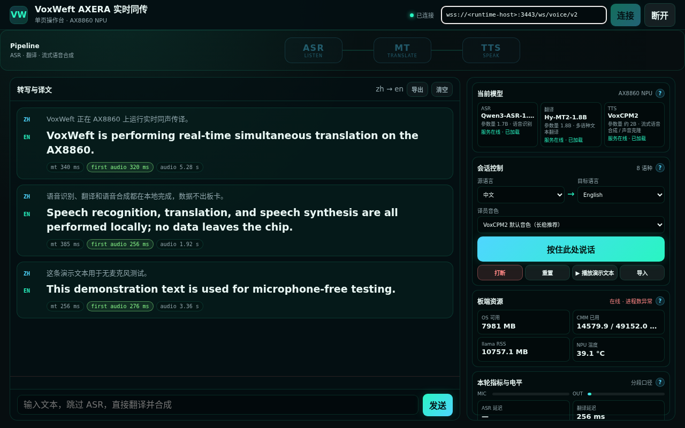
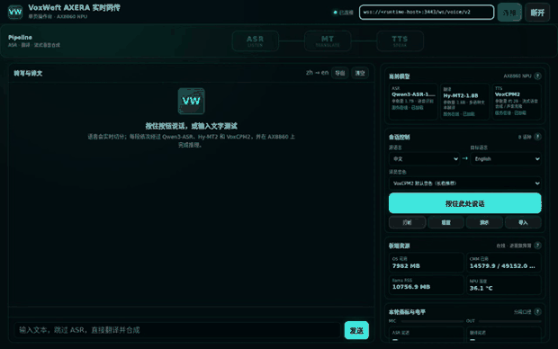

# VoxWeft AXERA

**VoxWeft AXERA** 是面向 **AX8860 / AX8860P** 的实时同声传译运行时。它保留原生
VoxWeft 的实时切句、编排、打断和 WebSocket 协议，将模型层替换为 AXERA
`llama.cpp` 服务：

```text
Qwen3-ASR → HY-MT2 → VoxCPM2
```

这个仓库是 **AXERA Linux / WebUI 路线**，不是原生 macOS / Apple MLX 演示仓库。
原生 VoxWeft 保留在 [HenryZ838978/VoxWeft](https://github.com/HenryZ838978/VoxWeft)。

---

## WebUI 预览

单页操作台包含 Pipeline 状态、转写 / 译文卡片、当前模型、会话控制、板端资源和
分段指标。右上角的 “?” 提供对应口径说明。



下面是一段无麦克风演示：点击“演示”后，文本依次经过 HY-MT2 翻译和 VoxCPM2
流式合成，界面同步显示 Pipeline 状态、译文卡片和延迟指标。



---

## 当前能力

- 实时语音同传：`ASR → 翻译 → 流式 TTS`
- Linux WebUI：
  - ASR / MT / TTS pipeline 状态灯
  - 每轮源文 / 译文卡片
  - ASR、翻译、TTS 首包和输出音频时长
  - 输入 / 输出音频电平
  - 板端 OS / CMM / RSS / NPU 温度状态
- 文本输入模式，跳过 ASR 直接测试翻译和合成
- 导入本地录音文件，浏览器解码后走同一条实时 ASR / 翻译 / TTS 链路
- 内置无麦克风演示文本
- VoxCPM2 默认音色与参考音色两种模式
- WebSocket 自动重连和本地播放打断
- AX8860 服务健康轮询；模型服务离线时显示具体端口并禁用相关操作
- ASR / 翻译请求的连接错误、超时、HTTP 5xx 与无效 JSON 自动重试
- TTS 建连阶段自动重试；长文本按句分段合成，失败后可从后续分段继续
- 转写与译文 JSON 导出
- 板端资源采样与报告脚本

当前支持翻译语言：

```text
zh / en / ja / ko / fr / de / ru / es
```

当前边界：

- 单会话运行；
- 每个 llama-server 使用 `-np 1`；
- 主要面向单用户实时同传，不是多租户服务；
- 本仓库不负责下载、转换或托管模型权重；
- 板端三个推理服务需要按各自模型卡预先启动。

---

## 架构

```text
Browser
  │ HTTP / WebSocket
  ▼
Linux VoxWeft runtime :3100
  ├── realtime segmenter
  ├── orchestrator / interruption state machine
  ├── AX ASR adapter
  ├── AX HY-MT2 adapter
  ├── AX VoxCPM2 streaming adapter
  ├── WebUI + /health
  └── board resource reader
        │ HTTP
        ▼
AX8860 / AX8860P board
  ├── Qwen3-ASR-1.7B      :18081  /v1/chat/completions
  ├── HY-MT2-1.8B         :18082  /v1/chat/completions
  ├── VoxCPM2              :18083  /v1/audio/speech
  └── tempmon              :8080   /api/stats
```

`scripts/run_ax8860.sh` 会加载 `.env.ax.local`，因此切换板卡地址不需要修改代码。

---

## 模型与 API

| 阶段 | 模型 | 参数量 | 默认端口 | API |
|---|---|---:|---:|---|
| ASR | Qwen3-ASR-1.7B | 1.7B | 18081 | `/v1/chat/completions` + `input_audio` |
| 翻译 | HY-MT2-1.8B | 1.8B | 18082 | `/v1/chat/completions` |
| TTS | VoxCPM2 | 约 2B | 18083 | `/v1/audio/speech` |

模型包来自 [AXERA-TECH](https://huggingface.co/AXERA-TECH)，权重和运行时包遵循各自
模型卡条款。本仓库只包含软件适配层，不重新分发模型权重。

### 音色模式

WebUI 可选择：

- **VoxCPM2 默认音色**：长稳演示推荐，TTS 首包更低；
- **参考音色**：使用 `samples/voices/` 中的 VoxWeft 音色种子，通过 VoxCPM2
  `ref_audio` / `ref_text` 做声音克隆。

参考音频会在进程内缓存为 16 kHz PCM，降低每次请求的 Base64 体积和板端内存压力。
缺失参考音色会自动回退到默认音色。

### 瞬时错误与长文本续跑

默认重试策略：

| 环境变量 | 默认值 | 含义 |
|---|---:|---|
| `AX_HTTP_RETRY_LIMIT` | `2` | 初始请求后额外重试次数 |
| `AX_HTTP_RETRY_DELAY` | `0.5` | 第一次重试延迟；后续按次数线性放大 |
| `VOXWEFT_SPEECH_RETRY_LIMIT` | `2` | 单个长文本 TTS 分段在未输出音频前额外重试次数 |

ASR 与 HY-MT2 的连接错误、超时、HTTP 5xx 和无效 JSON 会自动重试；HTTP 4xx
视为请求错误，不重试。HY-MT2 返回空结果时，会另行插入唯一 request ID 重试一次。

VoxCPM2 只在建立 HTTP 流之前自动重试。进入音频流之后如果连接中断，runtime 不
自动重发同一分段，避免用户听到重复语音。长文本协议会返回失败分段、下一段索引
与 `resumable` 标记；WebUI 可将其显示为“继续语音”，从后续分段继续。

---

## 安装

要求：

- Linux 主机可访问 AX8860 板卡端口；
- Python 3.10+；
- AX8860 板上已运行三个模型服务和 tempmon；
- HY-MT2 建议以 `--no-cache-prompt` 启动，避免重复 prompt 返回空结果。

### 1. 克隆并创建环境

```bash
git clone https://github.com/BUG1989/VoxWeft.axera.git
cd VoxWeft.axera

python3.10 -m venv .venv-ax
.venv-ax/bin/pip install -r requirements-ax.txt
```

### 2. 配置板卡地址

创建本地私有配置文件：

```bash
cat > .env.ax.local <<'ENV'
AX_BOARD_HOST=<board-ip>
AX_ASR_BASE=http://<board-ip>:18081/v1
AX_MT_BASE=http://<board-ip>:18082/v1
AX_TTS_BASE=http://<board-ip>:18083/v1
AX_STATS_URL=http://<board-ip>:8080/api/stats
ENV

chmod 600 .env.ax.local
```

`.env.ax.local` 已被 Git 忽略，不要提交真实 IP、token 或内网路径。

### 3. 启动 Linux runtime

```bash
scripts/run_ax8860.sh
```

打开：

```text
http://127.0.0.1:3100/
```

浏览器只在 `localhost` 或 HTTPS 页面允许麦克风采集。若通过远程 HTTP 访问，
请使用文本模式或内置演示文本；也可以用 SSH tunnel：

```bash
ssh -L 3100:127.0.0.1:3100 <user>@<runtime-host>
```

然后在本机访问：

```text
http://127.0.0.1:3100/
```

### 可选：局域网 HTTPS 入口

浏览器只在 secure context 中开放麦克风 API。除 SSH tunnel 外，也可以在本机启动
HTTPS 反向代理。先生成一张包含本机 IP 的自签名证书：

```bash
mkdir -p .certs
openssl req -x509 -newkey rsa:2048 -sha256 -nodes -days 3650 \
  -subj "/CN=<runtime-host>" \
  -addext "subjectAltName=IP:<runtime-host>,IP:127.0.0.1,DNS:localhost" \
  -keyout .certs/voxweft-axera.key \
  -out .certs/voxweft-axera.crt
chmod 700 .certs
chmod 600 .certs/voxweft-axera.key .certs/voxweft-axera.crt
```

启动代理：

```bash
VOXWEFT_HTTPS_HOST=0.0.0.0 \
VOXWEFT_HTTPS_PORT=3443 \
VOXWEFT_BACKEND_HOST=127.0.0.1 \
VOXWEFT_BACKEND_PORT=3100 \
node scripts/https_proxy.js
```

访问：

```text
https://<runtime-host>:3443/
```

自签名证书会触发浏览器警告。确认证书里的 IP 或域名正确后，可以选择继续访问；
生产环境建议使用受信任的内部 CA 或公共域名证书。

---

## 基本使用

### 1. 健康检查

```bash
curl -sS http://127.0.0.1:3100/health | python3 -m json.tool
```

`/health` 返回：

- 三个推理服务是否在线；
- 实际加载的 runtime model；
- 模型名称、参数量和用途；
- 可用参考音色；
- 板端 OS / CMM / RSS / 温度快照。

### 2. 文本模式

在 WebUI 底部输入文本，例如：

```text
人工智能正在改变边缘设备，实时同传必须在本地完成。
```

流程会跳过 ASR：

```text
文本 → HY-MT2 → VoxCPM2 → 流式播放
```

适合无麦克风环境、远程 HTTP 页面和快速回归。

### 3. 按住说话

在 localhost 或 HTTPS 页面中：

1. 选择源语言和目标语言；
2. 按住按钮说话；
3. 松开后提交语音段；
4. 查看 ASR、译文、TTS 首包和输出音频时长；
5. 需要时点击“打断”。

### 4. 无麦克风演示

点击：

```text
▶ 播放演示文本
```

WebUI 会逐句发送 AX8860 专用演示文本，走同一条翻译和 TTS 链路。

### 5. 导入录音文件

点击右侧会话控制中的：

```text
导入
```

支持浏览器可解码的常见音频格式，例如：

```text
WAV / MP3 / M4A / AAC / OGG / FLAC / WebM
```

浏览器会把文件解码为：

```text
mono 16 kHz PCM
```

再通过 WebSocket 送入 VoxWeft runtime。服务端仍使用实时切句，随后执行：

```text
Qwen3-ASR → HY-MT2 → VoxCPM2
```

限制：

```text
文件不超过 100 MB
时长不超过 10 分钟
```

导入音频不依赖麦克风权限，因此远程 HTTP 页面也可以使用。

---

## WebSocket 示例

最小文本轮次示例：

```bash
.venv-ax/bin/python - <<'PY'
import asyncio
import json
import websockets

async def main():
    url = "ws://127.0.0.1:3100/ws/voice/v2"
    async with websockets.connect(url) as ws:
        print(json.loads(await ws.recv())["type"])

        await ws.send(json.dumps({
            "type": "session_config",
            "mode": "interpreter",
            "src_lang": "zh",
            "tgt_lang": "en",
            "voice_mode": "default",
        }))
        print(json.loads(await ws.recv()))

        await ws.send(json.dumps({
            "type": "text_input",
            "text": "人工智能正在改变边缘设备。",
            "speak_source": False,
        }))

        while True:
            message = await ws.recv()
            if isinstance(message, bytes):
                continue
            event = json.loads(message)
            print(event.get("type"), event)
            if event["type"] in ("turn_end", "error"):
                break

asyncio.run(main())
PY
```

长文本轮次会额外发送分段事件：

```json
{"type": "speech_chunk_start", "index": 3, "total": 19, "text": "..."}
{"type": "speech_chunk_retry", "index": 3, "total": 19, "attempt": 1}
{"type": "speech_chunk_end", "index": 3, "total": 19, "samples": 96000}
```

如果某个分段已经输出部分 PCM 后失败，服务端返回：

```json
{
  "type": "error",
  "stage": "speech_chunk",
  "index": 3,
  "next_index": 4,
  "total": 19,
  "sent_samples": 480,
  "resumable": true
}
```

客户端可继续发送：

```json
{"type": "resume_speech"}
```

续跑从 `next_index` 开始，不重放已成功分段，也不重放已部分发送的失败分段。若
失败发生在源语言语音阶段，续跑完成剩余源语音后还会继续执行翻译与目标语言语音。

---

## 指标口径

WebUI 中的指标是分段指标，不是完整端到端总耗时。

| 指标 | 含义 | 不包含 |
|---|---|---|
| ASR 延迟 | 已提交语音段的 ASR 耗时 | 麦克风采集、VAD、按住按钮等待 |
| 翻译延迟 | HY-MT2 请求到译文返回 | ASR、TTS |
| TTS 首包 | TTS 请求到第一块可播放 PCM | ASR、翻译、浏览器调度 |
| 输出音频 | 已发送 PCM 按 48 kHz 折算时长 | 被打断后未发送部分 |

文本模式的首音频体感耗时可以近似看作：

```text
翻译延迟 + TTS 首包 + 浏览器播放调度开销
```

---

## 资源监控

采样板端资源：

```bash
AX_STATS_URL=http://<board-ip>:8080/api/stats \
  .venv-ax/bin/python scripts/monitor_ax_resources.py \
  --output /tmp/ax-resources.csv \
  --interval 2
```

生成 Markdown 报告：

```bash
.venv-ax/bin/python scripts/ax_resource_report.py \
  /tmp/ax-resources.csv \
  --markdown
```

报告包含：

- first / last / min / max；
- 首尾 10 次采样漂移；
- 采样错误数；
- llama 进程数；
- OS、CMM、RSS 和 NPU 温度。

判断内存问题时，应优先看 warmed-up 后是否出现长期单调增长，而不是单次请求峰值。

---

## 测试

无需连接板卡即可运行核心回归：

```bash
.venv-ax/bin/python -m pytest
```

覆盖：

- AX 语言路由；
- HY-MT2 prompt 与空结果重试；
- AX HTTP 瞬时错误重试与响应释放；
- 5000 / 10000 字长文本分段完整性；
- 长文本 TTS 失败续跑与不重放约束；
- 参考音色 payload；
- voice mode；
- WebUI 关键控件；
- demo 文本接口；
- orchestrator 状态转移。

---

## 目录结构

```text
voxweft/
  runtime/
    ax8860.py        AXERA ASR / MT / TTS adapters
    ax_web.html      Linux WebUI
    server.py        FastAPI + WebSocket runtime
    orchestrator.py  realtime turn state machine
    segmenter.py     audio segmentation / endpointing
    router.py        language and backend routing

scripts/
  run_ax8860.sh            runtime launcher
  monitor_ax_resources.py  board resource sampler
  ax_resource_report.py    CSV summary report

samples/voices/
  bundled reference voices and transcripts

docs/AX8860.md
  additional deployment notes
```

原生 macOS / Apple MLX 代码仍保留在仓库中，但不是这条 AXERA 路线的默认入口。

---

## Credits

- [HenryZ838978/VoxWeft](https://github.com/HenryZ838978/VoxWeft) —
  原生项目。本仓库复用其实时切句、orchestrator、打断模型、WebSocket 协议、
  多语言音色种子和产品交互语义；Linux WebUI 的 dashboard 与每轮 latency card
  也参考了原生 macOS Shell。
- [AXERA-TECH](https://huggingface.co/AXERA-TECH) —
  AX8860 llama.cpp 模型包，包括 Qwen3-ASR、HY-MT2 和 VoxCPM2。
- [OpenBMB/VoxCPM](https://github.com/OpenBMB/VoxCPM) —
  VoxCPM2 原始模型与实现。
- Qwen / Hy-MT2 相关模型和依赖保持各自 license 与上游条款。

---

## License

本仓库使用 [Apache License 2.0](LICENSE)。上游声明和模型权重边界见
[NOTICE](NOTICE)。

模型 checkpoint、板端 runtime 包和 NPU kernel 不由本仓库分发，请从各自官方发布地址
获取并遵循其条款。
